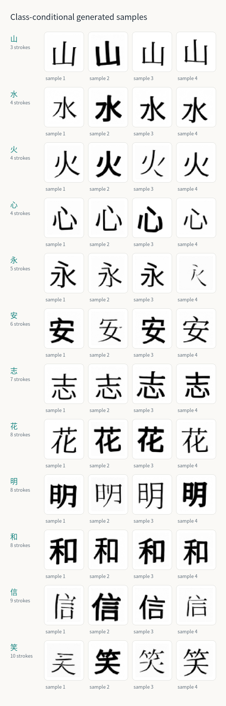
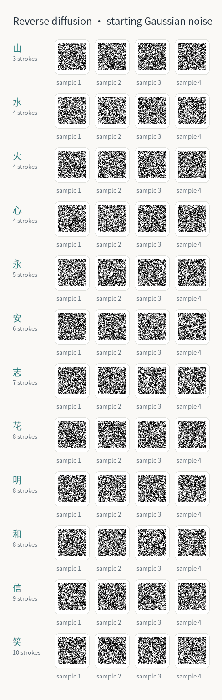

# 字生 (Zìshēng)

字生 is a STATS 100A Honors project on class-conditional diffusion for Chinese character images. Its current visual pilot trains a DDPM on rendered font glyphs and includes a saved checkpoint, a local interactive sampler, and a static sample gallery.

> **Status: runnable visual pilot.** The model generates samples for 12 character labels. Results have been inspected visually; the project has not measured recognition accuracy or generalization to unseen fonts.

## Technologies

- Python 3.12, PyTorch, NumPy, and Pillow.
- Noto Sans CJK SC Regular and Noto Serif CJK SC Regular provide the training glyphs. Their versions, hashes, and SIL Open Font License 1.1 terms are recorded in each run manifest.
- The saved run was trained on Apple MPS. The command line can also select CUDA or CPU.

## Features

- Generate 48×48 grayscale images for 山 (3 strokes); 水, 火, and 心 (4); 永 (5); 安 (6); 志 (7); 花, 明, and 和 (8); 信 (9); and 笑 (10).
- Choose one character, a batch of one to six samples, and a random seed.
- Watch the local page update with actual model states during sampling. It streams one state every 10 reverse steps, then lets you select a sample, scrub its path, or replay it at 30 frames per second.
- Use the included checkpoint for generation without retraining. After Python dependencies are installed, the sampler runs locally without downloading fonts or making network requests.

## The process

1. Render 256 variants of each character from two Simplified Chinese font families. The 3,072 grayscale images use small changes in size, line weight, position, and rotation.
2. Apply a 1,000-step DDPM forward schedule with linear beta values from 0.0001 to 0.02.
3. Train a compact U-Net to predict the added Gaussian noise, conditioned on both the timestep and character ID.
4. Sample from Gaussian noise and apply the learned reverse process. The web page streams 101 states for the current 1,000-step schedule.

The recorded run used training seed 42 and 8,000 optimizer updates. Its training noise-prediction MSE reached 0.0132. This is the training objective, not a recognition score.

## Preview

The images and animation below display directly on the GitHub repository page. No installation is needed to view them.





For a larger static report, open `demo/assets/expanded-12char-48px/index.html` in a browser after cloning or downloading the repository. Its images are stored beside it, so the report works locally without starting the model server. The [training trace](demo/assets/expanded-12char-48px/training_curve.png), [training examples](demo/assets/expanded-12char-48px/training_examples.png), and [dataset manifest](demo/assets/expanded-12char-48px/dataset_manifest.json) are also available.

## What the pilot shows

The model represents each character as a grayscale pixel array. It does not generate pen-stroke paths or stroke order. The class label identifies the character but does not specify image size or line weight. Since those appearances vary in the training data, different seeds can produce different apparent sizes and thicknesses. Some generated outputs are malformed or too heavy.

The character set spans 3–10 strokes, but counts are unevenly represented and each class has its own shape. The results do not establish a causal effect of stroke count, recognition accuracy, handwriting quality, or generalization to fonts the model has not seen. Stroke counts follow Unicode 18.0.0 Unihan `kTotalStrokes`; see [the data card](docs/data-card.md) for the full list and source.

## Running the project

### Open the saved model locally

Use Python 3.12. Install the project and its dependencies once:

```bash
python3.12 -m venv .venv
source .venv/bin/activate
python -m pip install -e .
```

Then launch the interactive page with the included checkpoint:

```bash
python -m zisheng web
```

The page opens at [http://127.0.0.1:8765](http://127.0.0.1:8765). Choose a character, set the sample count and seed, and press **Generate from noise**. Keep the terminal open while using the page; press `Ctrl+C` there to stop the local server. The checkpoint is at `demo/assets/expanded-12char-48px/zisheng-pilot.pt`.

To save a separate sample report from the checkpoint:

```bash
python -m zisheng sample \
  --checkpoint demo/assets/expanded-12char-48px/zisheng-pilot.pt \
  --output results/runs/new-samples \
  --open
```

### Train a new model

Training needs the Noto fonts. On the first run, the project downloads about 41 MB of font files and license texts into `data/fonts/`; the font files stay local and are ignored by Git.

```bash
python -m zisheng demo \
  --output results/runs/expanded-12char-48px \
  --steps 8000 \
  --seed 42 \
  --device auto \
  --open
```

The run writes its checkpoint, font hashes, dataset manifest, training trace, samples, and HTML report to the selected output directory.

## Project records

- [Project proposal](docs/proposal.md)
- [Diffusion mathematics and code map](docs/math.md)
- [Data card](docs/data-card.md)
- [Experiment protocol](docs/experiment-protocol.md)
- [Model card](docs/model-card.md)
- [Research log](docs/research-log.md)
- [First faculty brief](docs/meetings/2026-10-26-first-faculty-brief.md)

## Next work

Before drawing conclusions about recognizability, define a fixed recognition measure and a held-out-font split. The character counts should also be balanced more carefully if stroke count is part of the analysis. To control apparent size or line weight, normalize glyph bounds or add those properties as explicit model conditions.

## Video showcase

A screen recording has not been made. The reverse-process GIF above shows selected generated states.

## License

No license has been selected for the project code or checkpoint. The Noto font files are not included; their separate SIL Open Font License terms are documented in the [data card](docs/data-card.md).
