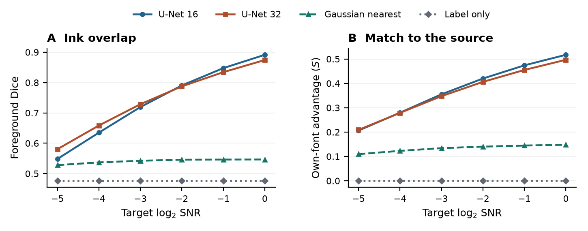
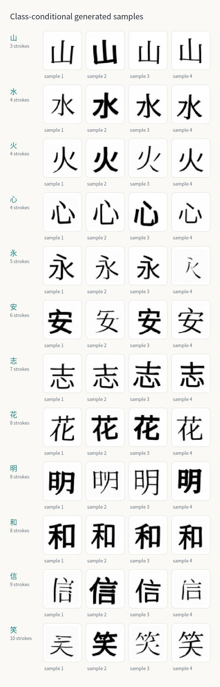
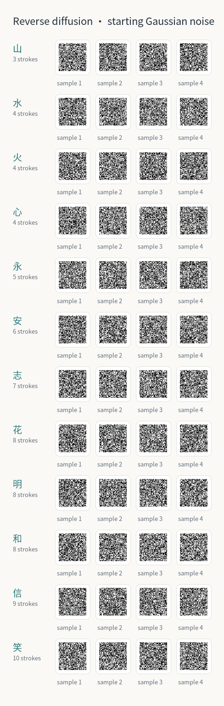

# 字生 (Zìshēng)

字生 is a STATS 100A Honors study of class-conditional diffusion for Chinese character images. It asks whether a small diffusion model can generate recognizable characters and how noise and stroke complexity relate to the result.

**Current status:** a completed held-out-font denoising study and a separate 12-character visual generation pilot. The study releases 24 characters rendered in six digital typefaces, four DDPM checkpoints, per-example scores, and a project report with independently checked results.

## Research study

A character can remain readable after its original stroke shapes have changed. We give the denoiser the right label and test whether it recovers those shapes from the noisy image. We also ask which glyphs are harder to recover and when extra model width helps. Local edge entropy lowered held-out-character prediction error by **0.144 Dice points** on average. Width 32 scored **3.22 points higher** at the strongest noise level and **1.71 points lower** at the mildest.

[Project report](report/glyph-entropy/paper.pdf) · [LaTeX](report/glyph-entropy/paper.tex) · [中文学习笔记](report/glyph-entropy/learning-notes.zh-CN.md) · [Data and split](data/study/) · [Models](models/glyph-entropy-v1/) · [Scores and audit](results/glyph-entropy-v1/) · [AI agent workflow](docs/agent-matrix.md)



## 🧰 Technologies

- Python 3.12, PyTorch, NumPy, and Pillow.
- Noto Sans CJK SC Regular and Noto Serif CJK SC Regular supply the rendered glyphs. Their versions, hashes, and SIL Open Font License 1.1 terms are recorded in the run manifest and [data card](docs/data-card.md).
- The saved run was trained on Apple MPS. The command line can also select CUDA or CPU.

The font files are downloaded for training and are not stored in this repository. A project license for the code and checkpoint has not been selected.

## ✨ Features

### Implemented

- Train a compact, character-conditioned DDPM on 48×48 grayscale images of 山, 水, 火, 心, 永, 安, 志, 花, 明, 和, 信, and 笑.
- Use the included checkpoint to generate one to six samples for a selected character and seed, without retraining.
- Run a local interactive page that streams actual reverse-process states. Select a sample, inspect its path, scrub the timeline, or replay it at 30 frames per second.
- Browse the sample grid and reverse-process animation directly on this GitHub page. No installation is needed for this preview.





The [static run report](demo/assets/expanded-12char-48px/index.html) and its images are also included for local viewing.

### Further work

- Add a character-identity metric and evaluate the generation-from-noise task.
- Vary character panels, test typefaces, and model widths to estimate where the observed patterns hold.

## 🔄 Development process

1. Render 256 variants of each character across two Simplified Chinese font families. Small changes in size, line weight, position, and rotation create 3,072 synthetic images.
2. Apply a 1,000-step DDPM forward schedule with linear beta values from 0.0001 to 0.02.
3. Train a compact U-Net to predict the added Gaussian noise, conditioned on the timestep and character ID.
4. Sample from Gaussian noise with the learned reverse process. The local page streams 101 actual states for the current 1,000-step schedule.

The recorded pilot used training seed 42 and 8,000 optimizer updates on Apple MPS. Training noise-prediction MSE reached 0.0132; this is the training objective, not a recognition score.

The written project records include the [proposal](docs/proposal.md), [diffusion mathematics and code map](docs/math.md), [experiment protocol](docs/experiment-protocol.md), [data card](docs/data-card.md), [model card](docs/model-card.md), and [research log](docs/research-log.md).

## 📚 What I learned

- A DDPM learns to predict the noise added at each timestep. A lower training MSE does not show that a generated image is recognizable.
- This model generates pixel arrays, not pen paths or stroke order. Image size and line weight are not separate conditions, so different seeds can produce different apparent thicknesses and sizes.
- Starting from Gaussian noise works best when the final forward step has removed nearly all signal. A 100-step schedule with the same beta endpoints left substantial signal, so the demo uses 1,000 steps.
- The samples include readable characters as well as malformed and unusually heavy outputs. The gallery is a qualitative pilot, not an accuracy result.

## 🌱 Future improvements

- Use a separate labeled recognition benchmark for legibility. This study measures mask recovery on two held-out font families.
- Compare more widths and training budgets before drawing a model-size scaling curve.
- Normalize glyph bounds or add image size and line weight as explicit conditions if those properties need to be controlled.
- Consider handwriting only after finding a suitable source with usable terms, sufficient character coverage, and a writer-level split.

## 🚦 How to run

### Reproduce the paper's evaluation

After installing the dependencies below, run from the repository root. The shipped data and weights make this a CPU reproduction.

```bash
python scripts/evaluate_glyph_entropy.py --split test --device cpu \
  --checkpoint-dir models/glyph-entropy-v1 --output results/runs/glyph-entropy-reproduction
python scripts/verify_glyph_entropy.py --data data/study \
  --checkpoint-dir models/glyph-entropy-v1 --evaluation results/glyph-entropy-v1 \
  --output results/runs/glyph-entropy-audit.json
```

To retrain the four research checkpoints, use `python scripts/train_glyph_entropy.py --device auto`. The [training configuration](configs/glyph_entropy.toml) defines the four runs. See the [paper build](report/glyph-entropy/) and [frozen protocol](docs/glyph-entropy-protocol.md) for the full reproduction procedure.

### Run the saved model locally

Use Python 3.12. Install the project and its dependencies once:

```bash
python3.12 -m venv .venv
source .venv/bin/activate
python -m pip install -e .
```

Then start the interactive sampler with the included checkpoint:

```bash
python -m zisheng web
```

Open [http://127.0.0.1:8765](http://127.0.0.1:8765) if it does not open automatically. Choose a character, sample count, and seed, then press **Generate from noise**. Keep the terminal open while using the page; press `Ctrl+C` there to stop the local server. After dependencies are installed, sampling uses the saved checkpoint locally and makes no network requests.

To save a separate sample report:

```bash
python -m zisheng sample \
  --checkpoint demo/assets/expanded-12char-48px/zisheng-pilot.pt \
  --output results/runs/new-samples \
  --open
```

### Retrain the generation pilot

Training downloads the Noto font files and license texts on the first run (about 41 MB). The font files stay local and are ignored by Git.

```bash
python -m zisheng demo \
  --output results/runs/expanded-12char-48px \
  --steps 8000 \
  --seed 42 \
  --device auto \
  --open
```

## 🎬 Video showcase

A screen recording has not been made yet. The reverse-process GIF above shows selected states from noise to the final samples.
