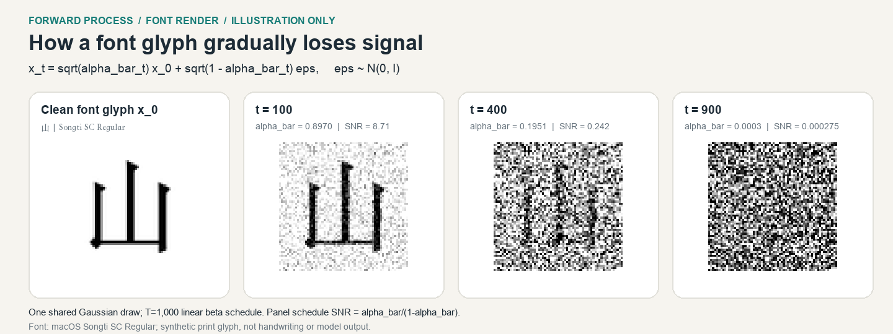

# First faculty brief: project scope and forward corruption

**STATS 100A Honors | Professor Wu | October 26, 2026**

## Research question

Can a small class-conditional diffusion model generate recognizable images of selected Chinese characters? How do Gaussian corruption and character stroke count relate to recognizability?

## Proposed study

- **Data:** begin with a controlled rendered-font pilot. Consider isolated handwriting for the main study only if the source, labels, writer-level splits, coverage, and use conditions can be verified. Keep the main analysis within one data domain.
- **Model:** condition a small denoiser on a character ID and timestep. Start with a three-character pipeline pilot, then scale to at least nine characters if the data and training gates pass; 24 is a target, not a commitment.
- **Evaluation:** assess requested-character identity separately from image fidelity. Treat stroke-count patterns as associations within the selected set, not evidence that stroke count causes performance differences.

## The first mathematical object

For a fixed clean image $x_0$, the forward marginal is

$$x_t = \sqrt{\bar{\alpha}_t}x_0 + \sqrt{1-\bar{\alpha}_t}\epsilon,\qquad \epsilon\sim\mathcal{N}(0,I).$$

Therefore, $x_t\mid x_0\sim\mathcal{N}(\sqrt{\bar{\alpha}_t}x_0,(1-\bar{\alpha}_t)I)$. The first formula constructs the corrupted image; the second states its conditional mean and covariance. This is the forward process, not the learned reverse process. See [Ho, Jain, and Abbeel (2020), Section 2, Equation 4](https://arxiv.org/abs/2006.11239).

**Figure status:** a deterministic illustration using 山 rendered in the locally installed macOS Songti SC Regular font and one seeded Gaussian-noise realization. Panel SNR labels show the schedule ratio $\bar{\alpha}_t/(1-\bar{\alpha}_t)$, not measured image SNR. It is a synthetic print glyph, not handwriting, an acquired training sample, model output, or research result. Values are clipped to $[-1,1]$ for display.

## Current status and next step

The repository contains planning notes and interface placeholders only. No dataset has been acquired, and no model has been implemented, trained, or evaluated. For the actual dataset, next choose an openly licensed font, verify character coverage and terms, then produce a labeled contact sheet.

## Questions for Professor Wu

1. Is rendered-font generation an acceptable controlled main domain if handwriting access or use terms delay the project?
2. Which should lead the evaluation: generated-character recognition or corruption/restoration of held-out images?
3. What report format, final deadline, and level of mathematical derivation should I plan for?
