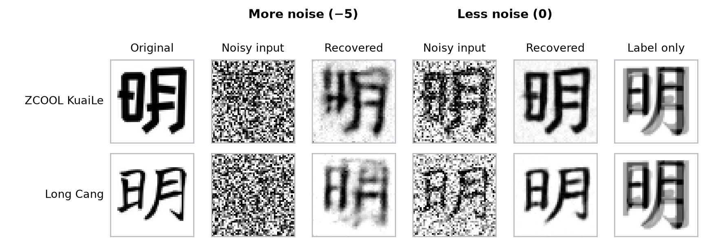

# 字生学习笔记

从两张「明」读懂 Gaussian noise、DDPM、字形熵和实验结果

UCLA STATS 100A Honors · 对照 [英文短论文](paper.pdf) 和 [冻结的实验方案](../../docs/glyph-entropy-protocol.md)

## 1. 先看图，同一个字可以有不同的正确答案

两行都是「明」。第一行的横竖比较粗，第二行更像手写。每行从左往右先看原图，再看加噪后的输入和模型给出的单步恢复。`More noise` 这组刚看到输入时，笔画几乎埋在噪声里。`Less noise` 这组能看到更多轮廓，恢复图也更像各自的原字。最右边的 `Label only` 在两行一模一样，因为它只知道答案是「明」，于是对三个训练字体里的「明」求平均。

旧 GitHub demo 做的是**生成**。输入是随机噪声和「明」的标签，经过 1,000 步得到一个可能的「明」。这份报告做的是**恢复**。我们先选定一张具体的「明」，加已知的噪声，再问模型能找回原来的墨迹多少。旧图册用仓库权重和原来的 seed 43 重跑后，样图与动画都逐字节复现。论文插图固定用宽度 32、训练 seed 101 和第 0 个噪声样本。用来得出结论的是全部 24 个字。 [旧 demo](https://github.com/Rainnnee/zisheng/tree/aff9ffd/demo/assets/expanded-12char-48px) · [冻结实验方案](../../docs/glyph-entropy-protocol.md)

## 2. 像素、标签和字体各代表什么

| 概念 | 在字生里是什么 |
| --- | --- |
| 字符标签（character ID） | 「明」在代码里对应一个整数。两种字体的「明」用同一个 ID。 |
| 字形（glyph） | 一个字用某种字体画出来的具体形状。模型处理的是它的灰度像素。 |
| 图像张量 | 一张图有 `1×48×48` 个数。批量输入的形状是 `[batch, 1, 48, 48]`。 |
| 灰度尺度 | 原图是 0 到 255。用 `gray / 127.5 - 1` 转成黑色 −1、白色 +1。 |
| 训练、验证、测试 | 以字体家族分开。模型见过测试的字符标签。测试问的是能否恢复未见字体中这些字的具体形状。 |

我们选了 24 个简体字，4、6、8、10 画各 6 个。每字用 6 种字体渲染，共 144 张干净字形。先从字体提取墨迹范围，再保持宽高比缩进 40 像素的框，放到 48×48 画布中央。训练选 Noto Sans CJK SC、ZCOOL XiaoWei、Ma Shan Zheng，验证用 ZCOOL QingKe HuangYou，测试用 ZCOOL KuaiLe 和 Long Cang。测试字体在训练前固定。数据检查了 264 对跨分组的同字字形，排除完全重复的灰度图和墨迹图。

只有训练字体做轻微平移和旋转。每张干净训练图保留原版，再生成 32 个变体，合计 `3 × 24 × 33 = 2,376` 张训练图。做字形测量和模板基线时用的是那些干净的标准版。 [数据卡与来源](../../data/study/README.md) · [训练数据代码](../../scripts/train_glyph_entropy.py)

## 3. 高斯噪声怎么盖住一张图

先只看一个像素。假设原来的墨迹值是 `−1`，这一档保留信号的权重平方为 $a_t=0.5$，抽到的标准正态噪声值是 `+1`。两个量都乘上 $\sqrt{0.5}$ 后相加，结果就是 0，也就是灰色。换一个噪声样本，灰度就会变。原像素固定时，这个带噪像素的均值是 $-\sqrt{0.5}$，方差是 0.5。这里 **均值**回答“反复加噪后中心在哪”，**方差**回答“随机抽出来会散多开”。

### 从一步走到第 $t$ 步

每一步保留前一张图的一部分，再加一份独立高斯噪声。记 $\beta_t$ 为这一步的新噪声方差，$\alpha_t=1-\beta_t$。

$$
X_t=\sqrt{\alpha_t}X_{t-1}+\sqrt{\beta_t}Z_t,\qquad Z_t\sim\mathcal N(0,I).
$$

$Z_t$ 在像素之间独立，每一步也重新抽。给定当前图 $X_{t-1}$，下一步就由它和新噪声决定。这就是这里的 **Markov chain（马尔可夫链）**。在代码里，$\beta$ 由 0.0001 线性增到 0.02，共 1,000 档。

高斯变量的线性组合仍是高斯。若前一步在给定原图时的条件方差是 $(1-a_{t-1})I$，这一步就是

$$
\alpha_t(1-a_{t-1})I+\beta_t I=(1-a_t)I,\qquad
a_t=\prod_{s=1}^{t}\alpha_s.
$$

独立性让交叉协方差为零，所以这里把方差加起来。条件均值则每步再乘 $\sqrt{\alpha_t}$，累计得到 $\sqrt{a_t}x_0$。因此整张图在第 $t$ 步的分布是

$$
X_t\mid X_0=x_0\ \sim\ \mathcal N\!\left(\sqrt{a_t}\,x_0,\,(1-a_t)I\right).
$$

这给了训练代码一个捷径。想要固定一档的图，直接取一次 $\epsilon\sim\mathcal N(0,I)$，计算 $x_t=\sqrt{a_t}x_0+\sqrt{1-a_t}\epsilon$。得到的分布与逐步加噪到这一档一样。比如 −5 档对应代码里从 0 起数的 index 586。实验对不同档复用同一张 $\epsilon$，这样可以配对比较同一份噪声在不同强度下的效果。 [`GaussianDiffusion.q_sample`](../../src/zisheng/diffusion.py)

### SNR 是什么

这里的 SNR 是两个系数平方的比值 $a_t/(1-a_t)$。取底数为 2 的对数后，横轴每右移一格，信号相对于噪声的权重比就翻倍。

| 论文图上的档位 | 权重比大约是多少 | 怎么读 |
| --- | --- | --- |
| $\log_2\mathrm{SNR}=-5$ | $1:32$ | 最强噪声档。信号的权重平方约是噪声的三十二分之一。 |
| $\log_2\mathrm{SNR}=0$ | $1:1$ | 本实验最温和的一档。两项的权重平方大致相同，图里仍有噪声。 |

这是由 schedule 定义的尺度。我们用同一尺度比较所有字形。

## 4. U-Net 预测的东西是什么

每次训练都先抽一张干净图、一个时间步和一张噪声。我们自己加的 $\epsilon$ 就是可用的训练答案。U-Net 的输入是带噪图 $x_t$、噪声档位 $t$、字符 ID $c$。输出 $\widehat\epsilon=\epsilon_\theta(x_t,t,c)$ 和输入图一样大。损失是每个像素上 $(\epsilon-\widehat\epsilon)^2$ 的平均。

| 算法部件 | 可以怎么理解 |
| --- | --- |
| 卷积（convolution） | 同一小块滤镜扫过整张图，在不同位置找相似的局部笔画或边缘。 |
| U-Net 下采样 | 48×48 压到 24×24，再到 12×12，让后面的层看到更大范围的字形。 |
| U-Net 上采样和跳接 | 回到 48×48 的同时接回较早层的细节，有助于保留笔画位置。 |
| 时间与字符嵌入（embedding） | 时间步先用正弦、余弦编码，字符 ID 查一个可学习的向量，两者相加后送进残差块。模型知道该恢复哪个字，以及噪声处在哪一档。 |
| 残差块、GroupNorm 和 SiLU | 残差块把新算出的特征加回较短的输入路径。GroupNorm 在通道组内标准化，SiLU 给网络非线性。 |
| AdamW、梯度裁剪与 EMA | 用 AdamW 更新权重，裁剪过大的梯度。EMA 以 `0.995` 的权重保留上一份权重平均、以 `0.005` 加入本次更新。测试加载这份移动平均。 |

宽度是第一层的特征通道数，改变它也会改变后续层的通道数。宽度 16 有 240,993 个参数，宽度 32 有 881,153 个参数，两者输出都是 48×48。每次训练用 4,000 次更新、每批 24 张。每个宽度跑 seed 101 和 202。在同一个 seed 下，共享抽到的训练图索引、时间步和加上的噪声。 [U-Net](../../src/zisheng/model.py) · [优化与 EMA](../../src/zisheng/train.py) · [研究配置](../../configs/glyph_entropy.toml)

### 为什么猜噪声仍可能得到一块灰色

平方损失有一个概率结论。固定可见条件 $X$，要用一个数 $b$ 猜随机变量 $Y$，有

$$
\mathbb E[(Y-b)^2\mid X]=\operatorname{Var}(Y\mid X)+(\mathbb E[Y\mid X]-b)^2.
$$

第一项与 $b$ 无关，第二项在 $b=\mathbb E[Y\mid X]$ 时最小。所以理想的 noise predictor 会学到「在眼前这些线索下，噪声的条件平均」。代回恢复公式，得到的是原图的**条件平均**。如果同一个位置等可能是墨迹 `−1` 或背景 `+1`，那么平均是 0。原图的笔画有时就这样变成了灰色。

Bayes 公式提供另一种理解。给定标签 $c$，某张干净图 $x_0$ 是原图的相对可能性，来自它本来就有多常见和它有多能解释这张带噪图。

$$
p(x_0\mid x_t,c)\ \propto\ q(x_t\mid x_0)\,p(x_0\mid c).
$$

$p(x_0\mid c)$ 是这个字的 **prior（先验）**，$q(x_t\mid x_0)$ 是观测的 **likelihood（似然）**。假设原图是两张「明」中的一张，先验各占一半。若眼前的带噪图在 A 下的似然是在 B 下的四倍，更新后的概率就是 A 占 80%、B 占 20%。若似然差不多，更新后的概率也接近各占一半。这个例子说明输入提供的证据怎样改变我们仅凭标签时的判断。第 6 节的交叉比较检查的是实际预测随输入变了多少。

## 5. 为什么一次恢复和 1,000 步生成看起来不同

**论文的单步恢复**把前向公式反过来。先减去猜出的噪声，再把缩小的信号放大回去。

$$
\widehat x_0=\frac{x_t-\sqrt{1-a_t}\,\widehat\epsilon}{\sqrt{a_t}},\qquad
\widehat x_0-x_0=\sqrt{\frac{1-a_t}{a_t}}\,(\epsilon-\widehat\epsilon).
$$

假如在两档上都把一个像素的噪声猜错 0.1，误差在 0 档会变成约 0.1，在 −5 档会变成约 0.57。因为 $\sqrt{32}\approx5.66$。这是「同样大小的噪声预测错误会怎样传到图上」的手算，可以帮助你读图里高噪声恢复发虚的地方。

**旧 demo 的反向采样**从 $x_T\sim\mathcal N(0,I)$ 开始。已知 $x_t$ 和字符 ID，U-Net 猜噪声，DDPM 用这个猜测决定下一小步的中心。前向高斯的条件计算给出这两个量。

$$
\mu_\theta(x_t,t,c)=\frac{1}{\sqrt{\alpha_t}}
  \left(x_t-\frac{\beta_t}{\sqrt{1-a_t}}\epsilon_\theta(x_t,t,c)\right),
\qquad
\widetilde\beta_t=\beta_t\frac{1-a_{t-1}}{1-a_t}.
$$

每次从以 $\mu_\theta$ 为均值、$\widetilde\beta_t I$ 为方差的高斯分布抽一小步，最后一步直接用均值。直观上，每一步都重新看当前图、重新猜当前噪声。数学上，$\widetilde\beta_t$ 来自两个高斯因子相乘得到的 $q(x_{t-1}\mid x_t,x_0)$，模型用自己的噪声预测来参数化反向均值。整个过程追求生成一个可行的字形样本。 [反向采样实现](../../src/zisheng/diffusion.py) · [DDPM 论文，第 2–3 节](https://arxiv.org/abs/2006.11239)

## 6. 怎么量「像原图」

### Dice 只数放对位置的墨迹

对灰度图以中点为界，把每个像素标成墨迹或背景。假如原图有 100 个墨迹像素，预测有 90 个，重合了 80 个，那么

$$
D=\frac{2\times80}{100+90}\approx0.842.
$$

这就是 **foreground Dice**。1 表示两个墨迹集合重合，0 表示没有墨迹重合。两图都空时实现约定给 1。只数墨迹可以避免大片白背景掩盖断笔。论文把 0.01 Dice 叫作 1 点。它衡量的是墨迹位置重合。认字率需要另外的识别任务。

### 两个简单对照

- **Label only。** 把同一个字的三个训练字形做逐像素灰度平均。仅靠字标签，它就能拿到 **47.62 Dice 点**。看到这一行时，先承认某些正确笔画本来就能从标签和常见字形猜到。
- **Gaussian nearest。** 从同字的三个训练模板中选。假设候选模板 $T$ 是原图，带噪图的条件均值就是 $\sqrt{a_t}T$。三个候选的噪声方差相同，所以最可能的候选正是使 $\|x_t-\sqrt{a_t}T\|^2$ 最小的那个。这给了一个只靠模板库、也会看带噪输入的对照。

### 两个「明」互相当对照

令 $A,B$ 分别是两种字体的干净「明」，$P_A,P_B$ 是两份带噪输入各自恢复出的墨迹。对 $P_A$，问它像 $A$ 的程度减去像 $B$ 的程度。对 $P_B$ 也问一次，只是把自己的原图 $B$ 放在前面。

$$
S=\frac{[D(P_A,A)-D(P_A,B)]+[D(P_B,B)-D(P_B,A)]}{2}.
$$

如果两次都输出同一张图，两项一正一负，正好抵消。这就是 label-only 的 $S=0$。手算一个例子，令 $A=\{1,2\}$、$B=\{2,3\}$。两份原图的 Dice 为 0.5。若每次都回传 $A$，算得 $S=0$。若两次都准确恢复各自的原图，算得 $S=(1-0.5+1-0.5)/2=0.5$。

| 方法 | 强噪声 −5 的 $S$ | 轻噪声 0 的 $S$ |
| --- | ---: | ---: |
| 只看标签 | 0 | 0 |
| Gaussian nearest | 0.110 | 0.148 |
| U-Net 宽度 16 | 0.206 | 0.517 |
| U-Net 宽度 32 | 0.209 | 0.497 |

即使最强噪声档，两种 U-Net 也保留了可测的原图偏好。噪声减弱时，这个偏好更明显。$S=0.497$ 的单位是 0–1 Dice 尺度上的匹配优势。原字形的相似程度、笔画粗细和位置都会影响它。要进一步把恢复效果拆成来自输入和来自标签的比例，需要为「比例」另定一个可以测量的量。 [实际评分](../../results/glyph-entropy-v1/summary.json) · [两项度量和对照实现](../../scripts/evaluate_glyph_entropy.py)

## 7. 局部熵到底在量什么

把字形变成黑白墨迹图，然后让一个 2×2 小方框在图上逐像素滑动。4 个位置各有两种状态，因此有 $2^4=16$ 种图案。把全白、全黑去掉，剩下 14 种带边缘的图案。对余下窗口重新数比例。例如只有两种图案出现，分别占四分之三和四分之一，则

$$
H=-\sum_i p_i\log_2p_i
  =-\tfrac34\log_2\tfrac34-\tfrac14\log_2\tfrac14
  \approx0.811\ \text{bits}.
$$

永远看到同一种图案时是 0 bit，两种图案各一半时是 1 bit。每种图案越均匀地出现，越难猜随机抽到的窗口是哪种。这里所谓「复杂」特指局部边缘图案有多少样。笔画数是在数整字分几笔写，墨迹占比是在数黑了多少像素，周长复杂度 $L^2/(4\pi A)$ 用墨迹面积 $A$ 和对着背景的四邻域边数 $L$ 区分同面积下边缘更曲折的形状。我们对每种测量在三个训练字体中分别取中位数。 [Shannon 熵的原文](https://people.math.harvard.edu/~ctm/home/text/others/shannon/entropy/entropy.pdf)

### 怎样检查熵有没有提供额外的信息

1. **先让每个字只贡献一个目标。** 在一个测试字体和一个模型宽度下，把每个字在噪声、seed 和噪声样本上的 Dice 平均。得到 24 个字的恢复分数。
2. **轮流藏起一个字的分数。** 每折在另 23 个字上拟合回归，再猜藏起来的分数。这样每个字都被预测一次。回归在当前测试字体内用其他字的分数训练。DDPM 本身训练时见过全部 24 个字符的标签。
3. **两次预测只差一个特征。** 第一版用笔画组、墨迹占比和周长复杂度。第二版加上 $H$。两个版本都在每折用训练行的均值和标准差处理连续变量。Ridge regression 在最小二乘误差上加 $\lambda\sum_j\beta_j^2$，这里 $\lambda=1$，四个笔画组的基准值不受惩罚。这样连续特征的系数可以更稳一点。
4. **用平均绝对误差比较。** 对每个藏起来的字算 $|\text{真实 Dice}-\text{预测 Dice}|$，再平均。四种字体与宽度组合等权汇总，加入熵以后误差从 **2.548 降到 2.404 Dice 点**，相差 **0.144 点**。

这个结果更新了两个直觉。局部熵确实补上了一点笔画数和墨迹几何没有说完的信息。改善幅度也很小，删掉一个字、把全套分析重做之后，改善范围是 **0.004 到 0.271 点**。这是一项针对本字表的敏感度检查。三个训练字体之间的熵排名也只得到 **0.52 到 0.72** 的 Spearman 相关。Spearman 比较两次排序有多一致。它提醒我们，同一个字换字体，边缘图案概率也会变。 [冻结回归方案](../../docs/glyph-entropy-protocol.md) · [逐字结果](../../results/glyph-entropy-v1/summary.json)

## 8. 怎样读模型宽度结果和审计

模型宽度的比较使用**配对差**。让两个模型看到同字、同一个字体、同一档、同一份噪声和同组训练 seed，先逐个输入算 `Dice(宽32) − Dice(宽16)`，再平均。输入难度会同时影响两边，配对帮助我们看见换宽度的差。概率里，同一对差值的方差是 $\operatorname{Var}(A-B)=\operatorname{Var}(A)+\operatorname{Var}(B)-2\operatorname{Cov}(A,B)$。两边随输入难度同向变化时，正协方差会让差值更稳定。

在 −5 档，宽模型领先 **3.22 Dice 点**。到 0 档，窄模型领先 **1.71 点**。把这两行一起读，比只看 **+0.53 点** 的整体平均更能看出发生了什么。本次固定的是样本暴露量和更新次数，两种宽度的参数量和计算量不同。每种宽度只有两个训练 seed，测试字体只有两种。要研究参数量按什么速率增长，需要先定质量门槛，再加多个宽度、训练重复和独立测试字体。 [噪声分档曲线](generated/curves.png)

独立审查把归档的墨迹图重新变回像素，复算了 18,432 条神经网络和 9,216 条基线评分。一个字会贡献许多重复观测，主分析的单位仍然是字。审查还以 CPU 重放了 192 条预测，记录了一个几乎正好在阈值上的像素因浮点差异翻转。归档评分与独立重算完全一致。 [审计记录](../../results/glyph-entropy-v1/audit.json)

## 9. 用小实验检查自己真的会了

| 先试着亲手做 | 可以从这里读代码 | 自检 |
| --- | --- | --- |
| 写 10 行 NumPy 或 PyTorch 加噪，再用真的 $\epsilon$ 反解。 | [`q_sample`](../../src/zisheng/diffusion.py) | 原图能恢复到浮点误差范围内。把猜测误差固定住，−5 档的图像误差会比 0 档大约 5.7 倍。 |
| 用两个极小墨迹集合算 Dice，再写出交叉对照。 | [`dice` 和 `crossed_source`](../../scripts/evaluate_glyph_entropy.py) | 两次回传同一张图时 $S=0$。用上面两个集合完美恢复时 $S=0.5$。 |
| 对一个 2×3 小图逐格数 2×2 模式。 | [`glyph_features`](../../scripts/evaluate_glyph_entropy.py) | 用 `[[0,0,0],[1,0,1]]` 会得到两个不同模式，各占一半，$H=1$ bit。 |
| 随机藏起一个字，只用其余字计算特征均值、标准差和两版预测。 | [`ridge` 和 `loco`](../../scripts/evaluate_glyph_entropy.py) | 修改被藏字的真实 Dice，会改变误差，但不会改变预测。 |
| 用一句话解释为什么旧 demo 的「明」可以更整齐。 | [旧采样入口](../../src/zisheng/sample.py) · [论文插图](generated/illustration.png) | 说清从随机噪声生成一个可行样本，与单步估计某张指定原图，两者的输入和目标分别是什么。 |

从现成权重复跑整个评分可以查阅 [仓库复现命令](../../README.md#reproduce-the-papers-evaluation)。如果把这份笔记交给另一个 ChatGPT 学习，可以按节来。先让它给一道上表里的题，等你自己推导或写出代码，再让它对照真实实现检查。
